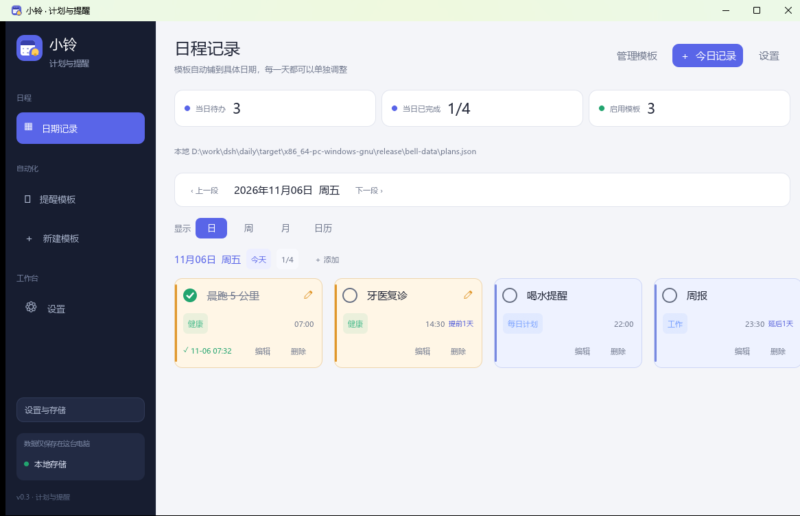
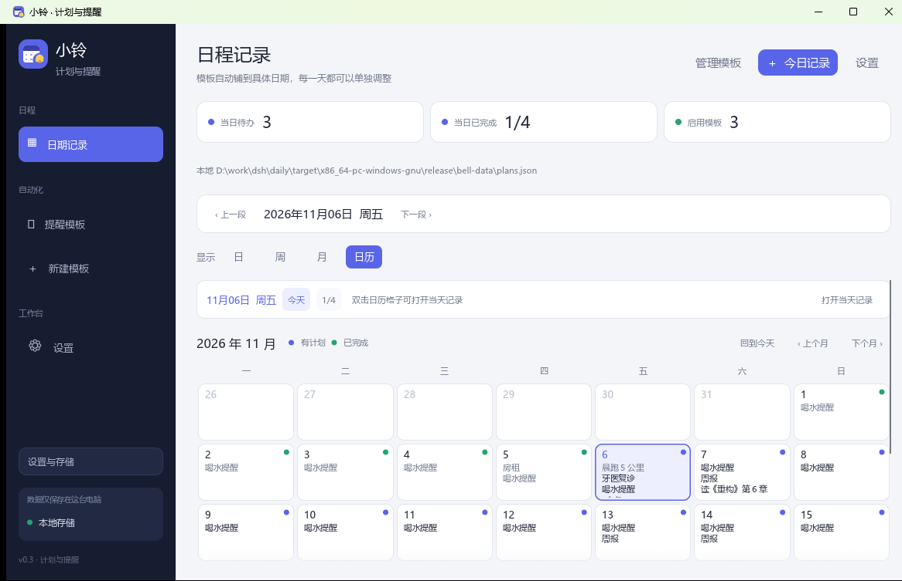
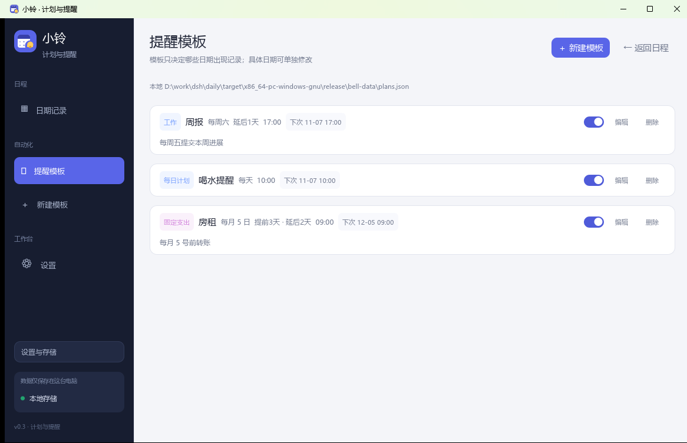
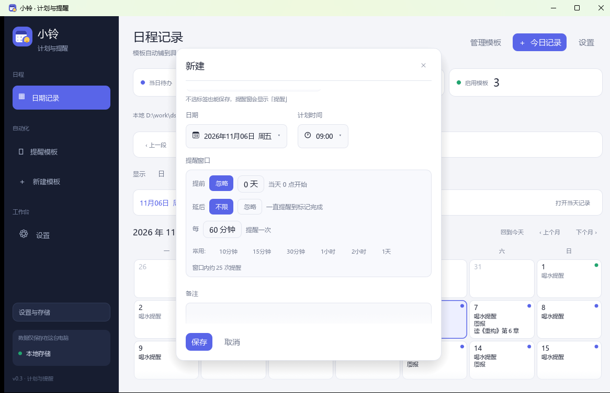
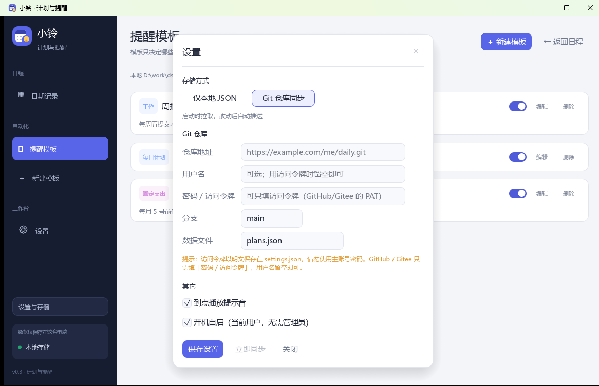

# 小铃（Bell）

一个面向个人使用的 Windows 计划与提醒工具，用 Rust + egui 写成，单文件、免安装、无 UAC。

核心模型是「**提醒模板 → 具体日期记录**」：模板决定哪些日期出现事项，而每一天的记录都可以单独编辑、完成、删除或补充备注——改某一天不会影响其他日期，也不会被模板覆盖回去。

## 界面预览

**按日期查看记录** —— 顶部三张指标卡，每张卡片显示标签、提醒窗口与完成状态：



**日历视图** —— 一眼看出哪天有计划、哪些已完成；双击格子打开当天记录：



**提醒模板** —— 每个模板显示周期规则、提醒窗口与下次提醒时间：



**新建记录** —— 提醒窗口的三个正交字段：提前 / 延后 / 间隔：



**Git 同步设置** —— 只填仓库地址与访问令牌即可（用户名留空）：



---

## 功能

### 记录与浏览

- **四种视图**：日 / 周 / 月 / 日历，前后翻页，一键回到今天
- **日历视图**：月历网格一眼看出哪些日期有计划、当天是否已完成；单击选中日期，**双击格子**弹出当天记录窗口
- **当天记录**：不需要模板时，可以直接给某一天添加一次性记录
- **独立编辑**：修改某天记录不影响其他日期或模板
- **独立完成**：每天单独完成/取消，进度按具体日期统计，完成时记录完成时间并显示在卡片上

### 提醒

- **周期模板**：每天、每周（多选星期）、每月（小月按月底）、每年（2 月 29 日平年按 28 日）
- **自动铺入**：模板会为指定日期生成独立记录，未来 90 天预生成
- **提醒窗口**：三个正交字段——提前 N 天开始、延后 M 天结束（勾「不限」则一直催到完成）、窗口内每 X 分钟提醒一次
- **逾期标记**：窗口结束仍未完成标「逾期」，不再提醒
- **提醒窗**：右下角置顶卡片，顶部显示「标签 + 标题」，底部两个按钮——「✓ 完成」（绿底白字）与「知道了」（收起本次提醒）

### 其他

- **标签分类**：模板/记录可打标签，下拉选择或直接输入新建，标签保存在字典里（即使暂时没有记录在用也会保留）
- **托盘常驻**：关闭主窗口后从任务栏隐藏并继续提醒
- **单实例**：重复启动不会开第二个窗口，而是把已有窗口唤到前台
- **开机自启**：写入 HKCU Run 键，无需管理员权限
- **数据存储**：默认仅本机 JSON；可选配置自己的 Git 仓库在多台机器间同步

---

## 快速开始

### 使用

双击 `bell-reminder.exe` 启动。

| 操作 | 方式 |
|---|---|
| 查看某天 | 日期页前后切换，或点「回到今天」 |
| 查看某天全部记录 | 日历视图**双击格子**；或点月历上方「打开当天记录」 |
| 添加一次性事项 | 日期页「＋ 当天记录」或某日期右侧「添加」 |
| 新建周期模板 | 侧栏「新建模板」或「提醒模板」页 |
| 单独修改某天 | 记录右侧「编辑」 |
| 完成某天 | 记录左侧圆形勾选框，或提醒弹窗「完成」 |
| 删除某天记录 | 记录右侧「删除」，模板不会在同一天重新补回 |
| 隐藏到托盘 | 点窗口右上角 × |
| 恢复窗口 | 双击 exe、托盘单击，或托盘菜单「打开主界面」 |
| 彻底退出 | 托盘菜单「退出」 |

### 从源码构建

需要 Rust 工具链与 MinGW（GNU 目标）：

```powershell
cargo +stable-x86_64-pc-windows-gnu test  --target x86_64-pc-windows-gnu
cargo +stable-x86_64-pc-windows-gnu build --release --target x86_64-pc-windows-gnu
```

产物：`target\x86_64-pc-windows-gnu\release\bell-reminder.exe`

构建时 `build.rs` 会把图标与 `asInvoker` 清单嵌进 exe（依赖 `windres`；缺失时仅告警跳过，无清单时系统默认同样是 asInvoker）。

---

## 数据位置

数据目录固定取 **exe 同级目录下的 `bell-data`**，而不是 `%APPDATA%`。这样桌面快捷方式、开机自启、直接双击 exe 都会读写同一份数据，不会因为启动方式不同而「看不到之前的记录」。

| 文件 | 路径 | 说明 |
|---|---|---|
| 数据 | `<exe 目录>\bell-data\plans.json` | 模板 + 日期记录（**唯一数据源**） |
| 设置 | `<exe 目录>\bell-data\settings.json` | 存储方式、Git 配置、提示音、自启 |
| 同步中转 | `<exe 目录>\bell-data\repo\` | 仅启用 Git 时的临时工作副本，可随时删除 |

- **原子写入**：先写 `.tmp` 再 rename 替换，避免写一半断电导致数据损坏
- **数据版本 v2**：`templates` 存提醒规则，`records` 存具体日期记录
- **自动迁移**：旧版 v1 的 `plans` 数据会自动迁移，完成/提醒状态落到对应日期记录，不丢失
- **改名迁移**：首次以新名字启动时，若同级只有旧的 `daily-reminder-data`，会自动改名过来
- **隔离测试**：环境变量 `BELL_DATA_DIR` 可指向别的目录

> ⚠️ 数据目录跟着 exe 走，**移动 exe 必须连 `bell-data` 一起移动**，否则会变成一份空数据。

---

## Git 同步（可选）

设置页把存储方式切到「Git 仓库同步」即可。设计上有一个关键点：

> **`plans.json` 永远是唯一数据源，`repo/` 只是同步中转。**

这意味着：

- 不管有没有配置 Git，界面读写的都是同一个 `bell-data\plans.json`
- `repo/` 损坏、被删、重新 clone 都不影响你的数据
- 不会出现「本机和 repo 各有一份、不知道哪份是对的」

### 工作流程

```
本地改动 → 写 plans.json（瞬间完成，不联网）
        → 后台把内存里的最新数据写进 repo/ → commit → push

启动 / 点「立即同步」
        → 后台 fetch 远端 → 把远端内容写回 plans.json → 重新读盘刷新界面
```

- 所有网络操作都在后台线程，界面不会卡住
- 同一时刻只跑一个网络任务；期间攒下的改动会在任务结束后自动补推
- 远端仓库为空时不会用空数据覆盖本地

### 建议：数据单独放一个私有仓库

代码可以公开，个人计划不该公开。推荐建一个**私有仓库专门放数据**，而不是塞进代码仓库：

```
<你的账号>/<某个私有仓库>    只放 plans.json
```

设置页指向这个仓库即可 —— **分支可以不是 `main`**：

```
仓库地址：       https://github.com/<你>/<私有仓库>.git
密码 / 访问令牌： <PAT>
分支：           plans
数据文件：       plans.json
```

程序只读写该分支上的 `plans.json`，仓库根目录多放几个无关文件也无妨。

### 凭据：直接用访问令牌

只需要填两项：

```
仓库地址：       https://github.com/<你>/daily.git
密码 / 访问令牌： <你的 Personal Access Token>
```

**用户名留空即可** —— 程序会以 `oauth2:<token>@` 的形式把凭据交给 git（GitHub / Gitee 都不校验这个占位用户名，但 URL 必须带非空用户名才会触发 Basic 认证）。

令牌权限要求：

| 平台 | 需要的权限 |
|---|---|
| GitHub | `Contents: Read and write`（细粒度 PAT）或 `repo`（经典 PAT） |
| Gitee | `projects` |

> 🔒 **令牌以明文保存在 `settings.json`**。建议单独创建一个只对这一个仓库有权限的令牌，不要用主账号密码或全权限令牌。

---

## 项目结构

```text
src/
  main.rs    UI（日期记录 / 提醒模板 / 日历 / 设置 / 提醒弹窗）、标签下拉、托盘、单实例、生成与调度
  model.rs   模板规则、日期记录、v1→v2 迁移与核心测试
  store.rs   JSON 本地存储 + Git 同步中转
  notify.rs  Windows 内存提示音（PlaySound 播内嵌 wav，无外部文件依赖）
assets/
  icon.ico / icon.png  程序与托盘图标
  notify.wav           提示音
  app.rc               资源脚本（图标 + 清单）
  app.manifest         asInvoker 清单（免 UAC）
  gen_assets.py        重新生成图标与提示音的脚本
```

---

## 设计说明

### 隐藏到托盘用的是「分层透明」而不是 `SW_HIDE`

关闭按钮只把主窗口设成 `WS_EX_LAYERED`（全透明）+ `WS_EX_TOOLWINDOW`（移除任务栏按钮），**不**调 `SW_HIDE`。原因：`SW_HIDE` 之后 winit 不再派发重绘事件，事件循环停摆，表现为「托盘点了没反应、到点也不弹提醒」。

### 首帧不创建托盘

托盘创建要和 Windows 通知区交互（实测约 20ms）。放在首帧会把这一帧拖到 30ms 以上，而 eframe 对「不可见窗口」每 100ms 补画一次——首帧越慢，窗口在内容画好之前被显示/隐藏的次数就越多（肉眼是启动时白窗闪两三下）。推迟一帧后首帧只剩纯绘制（约 8ms）。

### 标题栏强制浅色

eframe 0.37 会把窗口的 `DWMWA_USE_IMMERSIVE_DARK_MODE` 设成深色，而界面是浅色主题，标题栏会突兀地变黑。程序在第 2–6 帧显式把它写回 0。

### 所有 git 子进程带 `CREATE_NO_WINDOW`

release 版是 GUI 子系统，自己没有控制台。此时拉起控制台程序（`git.exe`）会让 Windows 为子进程新建一个控制台窗口，屏幕上黑框闪一下。`CREATE_NO_WINDOW` 消除这个现象。

### 数据模型边界

- 模板只负责生成，不承担某一天的完成状态
- 已在日期范围中的记录不会被重复生成
- 删除的模板记录以墓碑保留，避免同一天被自动补回
- 单独改过或已完成的记录不会被模板未来的修改覆盖

---

## 已知约束

- **单实例**靠命名互斥量 `Local\bell-single-instance`：第二个进程不新开窗口，发信号唤起已有窗口后自身退出（进程结束系统自动释放，无需手工清理）
- **提醒只对「当天已生成且未完成」的记录触发**，跨天不补发前一天的提醒
- **修改 exe 后需重启程序**才生效（运行中的进程持有旧代码）
- **窗口尺寸/最大化状态**保存在 `%APPDATA%\bell-reminder\data\app.ron`（eframe 的持久化）
- 用了中文系统字体（微软雅黑 + Segoe UI Emoji），Windows 之外不保证字形

---

## 依赖版本

GUI 使用 **egui / eframe 0.37**（glow 后端）。选这个版本是因为它修掉了 Windows 输入法的两个问题：

- 输入法处理过的按键（`VK_PROCESSKEY`）不再漏成普通按键事件——拼音候选没选定时按回车不会误触发提交/失焦
- 组字中的预编辑文本（preedit）由 `ImeEvent::Preedit` 统一维护——不再出现「拼音不显示」或「上屏后字母没回填」

`src/main.rs` 里的 `tag_combo()` 额外做了一层保护：本帧还在组字状态时，回车和 Esc 都不做提交/关闭处理。

---

## 许可

[MIT](LICENSE) © 2026 ghuan
