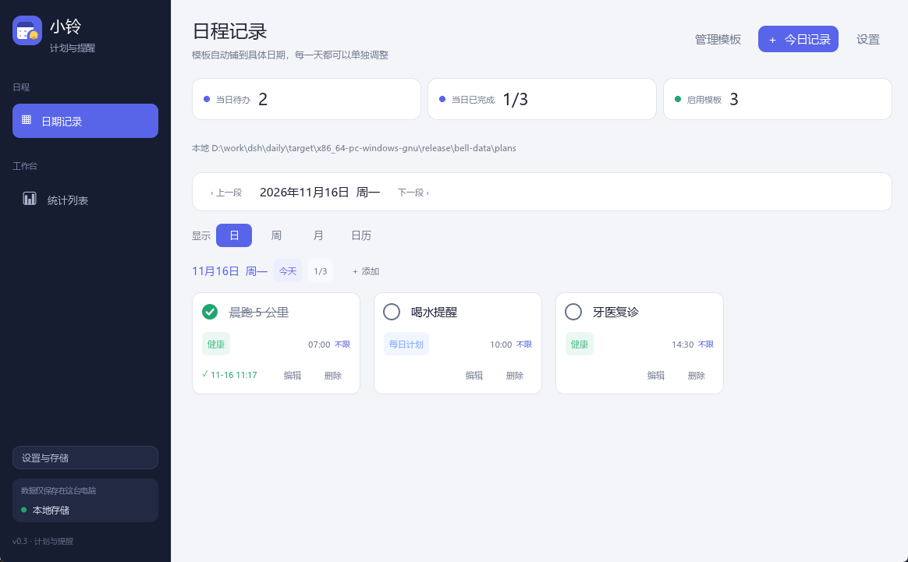
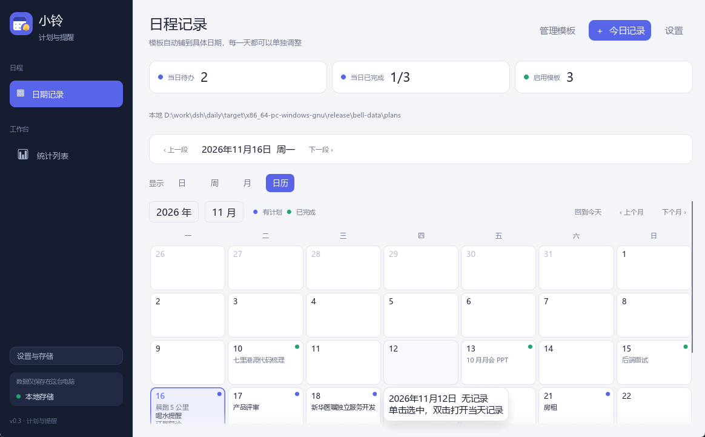
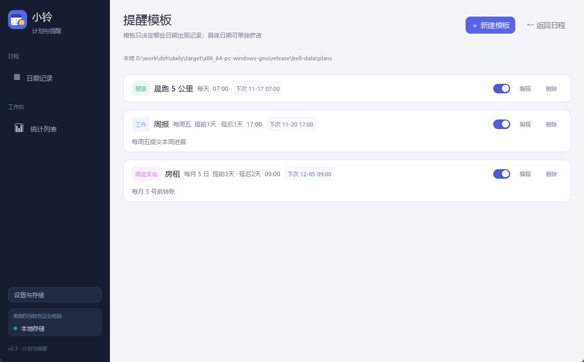
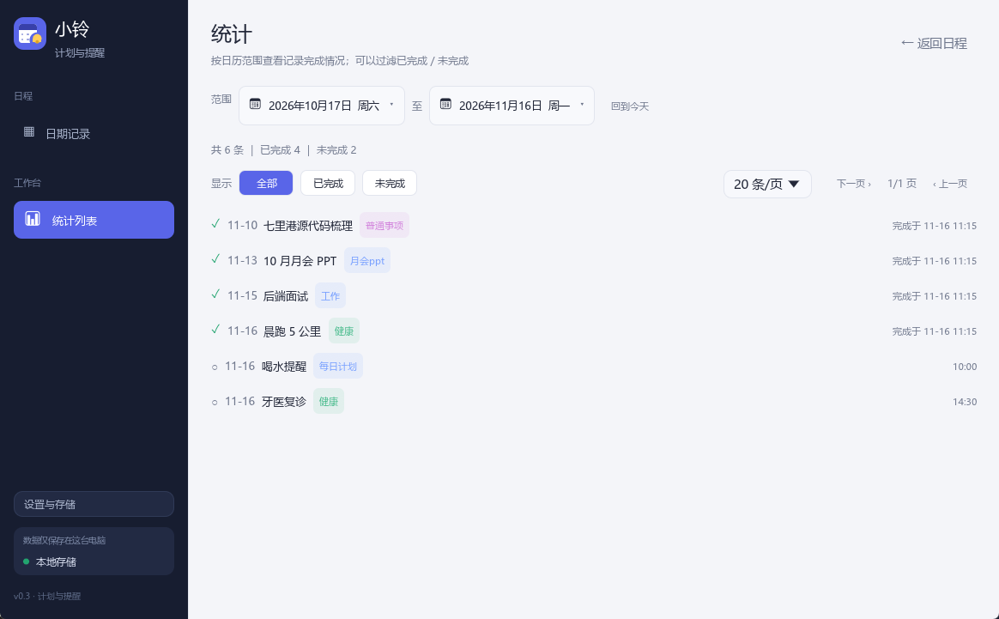

# 小铃（Bell）

面向个人的 Windows 计划与提醒工具。Rust + egui 写成，单文件、免安装、无 UAC。

核心模型是「**提醒模板 → 具体日期记录**」：模板决定哪些日期出现事项，每一天的记录可以单独编辑、完成、删除或备注——改某一天不影响其他日期，也不会被模板覆盖回去。

## 界面预览

**日视图** —— 顶部三张指标卡（待办 / 已完成 / 启用模板），下方按日期列出当天记录：



**日历视图** —— 一眼看出哪些日期有计划（蓝点）、哪些已完成（绿点）；双击格子打开当天记录：



**提醒卡片** —— 右下角堆叠置顶，显示标签、标题、计划时间与备注；两个按钮带悬停高亮：


**提醒模板** —— 每个模板显示周期规则、提醒窗口与下次提醒时间：



**统计列表** —— 按日期范围汇总已完成 / 未完成，可过滤、可翻页：



## 功能

### 记录与浏览

- **四种视图**：日 / 周 / 月 / 日历，前后翻页，一键回到今天
- **日历网格**：深色点表示有计划，绿色表示已完成；单击选中日期，**双击格子**弹出当天记录
- **独立编辑**：修改某天记录不影响其他日期或模板
- **独立完成**：每天单独完成/取消，完成时记录完成时间并显示在卡片上
- **一次性记录**：不需要模板时可直接给某天添加

### 提醒

- **周期模板**：每天 / 每周（多选星期）/ 每月（小月按月底）/ 每年（2 月 29 日平年按 28 日）
- **自动铺入**：模板为未来 90 天预生成独立记录
- **提醒窗口**三个正交字段：
  - **提前**：忽略 / N 天（从计划日 0 点起算）/ N 分钟（从计划时刻往前推）
  - **延后**：N 天后停止提醒；勾「不限」则一直催到完成
  - **间隔**：窗口内每 X 分钟重响一次
- **逾期标记**：窗口结束仍未完成标「逾期」，不再提醒
- **提醒卡片**：右下角置顶，显示「标签 · 标题」+ 计划时间 + 备注，底部「✓ 完成」（绿底）与「知道了」

### 统计

- 按任意起止日期查询，汇总总数 / 已完成 / 未完成，可只看某一类，支持分页

### 其他

- **标签分类**：下拉选择或直接输入新建，标签保存在字典里（暂无记录在用也保留）
- **托盘常驻**：关闭主窗口后收进托盘并继续提醒
- **单实例**：重复启动不开第二个窗口，而是唤起已有窗口
- **开机自启**：写入 HKCU Run 键，无需管理员权限
- **数据存储**：默认仅本机 JSON；可选配置自己的 Git 仓库多机同步

## 快速开始

双击 `bell-reminder.exe` 启动。

| 操作 | 方式 |
|---|---|
| 查看某天全部记录 | 日历视图**双击格子** |
| 添加一次性事项 | 右上「＋ 今日记录」 |
| 新建周期模板 | 右上「管理模板」→「＋ 新建模板」 |
| 查询记录范围 | 侧栏「统计列表」 |
| 设置 / 存储方式 | 侧栏底部「设置与存储」 |
| 完成某天 | 记录左侧圆形勾选框，或提醒卡片「完成」 |
| 删某天记录 | 记录右侧「删除」（模板不会在同一天补回） |
| 收进托盘 | 点窗口 ×（**最小化按钮同样收进托盘**，见「设计要点」） |
| 恢复窗口 | 双击 exe / 托盘单击 / 托盘菜单「打开主界面」 |
| 彻底退出 | 托盘菜单「退出」 |

### 从源码构建

需要 Rust 工具链与 MinGW（GNU 目标）：

```powershell
cargo +stable-x86_64-pc-windows-gnu test  --target x86_64-pc-windows-gnu
cargo +stable-x86_64-pc-windows-gnu build --release --target x86_64-pc-windows-gnu
```

产物：`target\x86_64-pc-windows-gnu\release\bell-reminder.exe`

构建时 `build.rs` 会把图标与 `asInvoker` 清单嵌进 exe（依赖 `windres`，缺失时仅告警跳过）。

### 演示模式

截图/调样式时可带参数启动，注入内存里的演示数据（**不读写真实数据**）：

```powershell
bell-reminder.exe --demo                          # 演示数据，日历视图
bell-reminder.exe --demo --demo-view=day          # 日视图
bell-reminder.exe --demo --demo-page=stats        # 统计页
bell-reminder.exe --demo --demo-page=templates    # 模板页
bell-reminder.exe --demo --demo-popups            # 同时弹提醒卡片
```

## 数据位置

数据固定放在 **exe 同级的 `bell-data`** 目录（不是 `%APPDATA%`），这样快捷方式、开机自启、直接双击都读写同一份数据，不会「看不到之前的记录」。

| 文件 | 说明 |
|---|---|
| `bell-data\plans\data.json` | 模板、标签字典、按年文件清单（唯一数据源） |
| `bell-data\plans\<年份>.json` | 该年全部日期记录，按年分文件 |
| `bell-data\settings.json` | 存储方式、Git 配置、提示音、自启 |

- **原子写入**：先写 `.tmp` 再 rename，避免写一半断电损坏
- **按年分文件**：避免单文件无限膨胀
- **自动迁移**：旧版 v1 数据会迁移到 v2 结构
- **隔离测试**：环境变量 `BELL_DATA_DIR` 可指向别的目录

> ⚠️ 数据目录跟着 exe 走，**移动 exe 必须连 `bell-data` 一起移动**。

## Git 同步（可选）

设置里把存储方式切到「Git 仓库同步」。关键设计：**`bell-data\plans\` 本身就是一个 git 工作副本**，没有中转目录——数据目录和 git 工作区是同一个地方，不存在「两份数据哪份对」的问题。

```
增删改 → 立即写盘 → 排入推送队列（3 秒防抖）
                  → 到点且空闲 → 同步：
                      远端无新提交 → 本地 commit + push
                      远端有新提交、本地无改动 → pull
                      两边都有改动 → 本机改动存为冲突副本分支 → 跟随远端

空闲时每 60 秒自动 poll 一次，拉取其他设备的改动
```

- 所有网络操作在后台线程，界面不卡；同步过程中提醒卡片不会被清掉
- 同一时刻只跑一个网络任务，期间攒下的改动等结束后自动补推
- 远端仓库为空时不会用空数据覆盖本地
- 「立即同步」可立刻触发一轮，不等防抖

### 冲突副本

两台机器同时改同一份数据时，程序**不中断你的操作**：

1. 本机改动提交到 `conflict/<yyyyMMdd-HHmmss>` 分支（并推到远端）
2. 主数据跟随远端更新
3. 侧栏出现「⚠ N 份冲突副本待处理」，点开可查看差异并选择**用副本覆盖**或**删除副本**

### 配置示例

数据建议单独放一个**私有仓库**（分支可以不是 `main`）：

```
仓库地址：       https://github.com/<你>/<私有仓库>.git
密码 / 访问令牌： <PAT>
分支：           plans
数据目录：       plans
```

**用户名留空即可** —— 程序以 `oauth2:<token>@` 形式把凭据交给 git（GitHub / Gitee 都不校验这个占位用户名，但 URL 必须带非空用户名才会触发 Basic 认证）。

| 平台 | 令牌权限 |
|---|---|
| GitHub | `Contents: Read and write`（细粒度 PAT）或 `repo`（经典 PAT） |
| Gitee | `projects` |

> 🔒 令牌以明文存在 `settings.json`。建议单独创建一个只对该仓库有权限的令牌，不要用主账号密码或全权限令牌。

## 项目结构

```text
src/
  main.rs   UI（日期记录 / 模板 / 日历 / 统计 / 设置 / 提醒卡片 / 冲突副本）、
            标签下拉、托盘、单实例、提醒调度
  model.rs  模板规则、日期记录、提醒窗口计算、v1→v2 迁移与核心测试
  store.rs  本地 JSON 存储（按年分文件）+ Git 同步（pull / push / 冲突分支）
  notify.rs Windows 内存提示音（PlaySound 播内嵌 wav，无外部文件依赖）
assets/     图标、提示音、资源脚本、asInvoker 清单
```

## 设计要点

改这些地方之前请先读——都是「看着可以简化、实际会坏」的：

- **隐藏到托盘用「分层透明」而非 `SW_HIDE`**：`SW_HIDE` 后 winit 不再派发重绘事件，事件循环停摆，表现为「托盘点了没反应、到点也不弹提醒」。程序用 `WS_EX_LAYERED`（全透明）+ `WS_EX_TOOLWINDOW`（移出任务栏）
- **最小化被拦截为「收进托盘」**：真最小化会把客户区压成 0×0（实测 `client=0x0`），而 WGL 的 surface 不支持 resize，在 0×0 上 swap_buffers 会崩（Intel 核显实测多次）。子类化窗口拦截 `SC_MINIMIZE`，转走隐藏流程。
  - 为什么不能改配置绕开：eframe 的 `App` trait 没有任何钩子能干预「是否画这一帧」，决定权在 `glow_integration.rs` 的 `if is_visible { ... }` 内部；`NativeOptions` 也只有 `multisampling` / `depth_buffer` / `renderer` 三个相关项。
  - 为什么换成 wgpu 也不行：wgpu 默认走 Vulkan，而本机 Intel Vulkan 驱动（`igvk64.dll` 27.20.100.8783）在初始化阶段直接 AV；强制 DX12 能起来，但最小化/恢复时 surface 重建会让整个程序卡死。
  - 为什么 deferred viewport 也不行：eframe 的渲染判定是 `show_ui = 主窗口可见 || 任意子 viewport 可见`，只要提醒卡片可见，最小化的主窗口照样会被拉去渲染。
- **提醒卡片是独立 OS 窗口**，定位必须用**弹窗自己的** `pixels_per_point` 换算（物理像素 → points → egui-winit 再乘回同一系数）。用主窗口缓存的值在 RDP 重连后会漂到屏幕中间
- **提醒调度跑在 `logic()` 而不是 `ui()`**：窗口最小化时 `ui()` 根本不执行，且 eframe 只在「有 repaint 请求」时才补跑。另有后台线程每秒 `request_repaint` 维持心跳
- **托盘退出必须显式 `NIM_DELETE`**：`process::exit()` 不跑析构，`TrayIcon::drop()` 里的删除不会执行，图标会残留到鼠标划过才消失
- **首帧不创建托盘**：`TrayIconBuilder::build()` 要约 20ms，放首帧会让窗口在内容画好前反复显示/隐藏（启动白窗闪烁）
- **标题栏强制浅色**：eframe 0.37 默认把 `DWMWA_USE_IMMERSIVE_DARK_MODE` 设成深色，与浅色界面冲突，第 2–6 帧写回 0
- **git 子进程带 `CREATE_NO_WINDOW`**：GUI 子系统拉 `git.exe` 会让系统新建控制台窗口，屏幕闪黑框
- **持久化窗口尺寸要校验**：`persist_window` 会照抄上次尺寸，一旦被缩到极小（实测出现过 64×64）就再也回不来，启动时剔除异常小尺寸
- **按钮 hover 用 visuals 而不是事后覆盖**：`Button::fill` 是固定色；用 `painter` 事后画色块会盖住文字，正确做法是 `ui.scope` 里改 `visuals.widgets` 的 `weak_bg_fill` 三档

## 已知约束

- **单实例**靠命名互斥量 `Local\bell-single-instance`：第二个进程唤起已有窗口后自身退出
- **提醒只对「已生成且未完成」的记录触发**，跨天不补发前一天的提醒
- **修改 exe 后需重启程序**才生效
- **窗口尺寸记忆**：正常尺寸会被记住，异常小的（<600×440）启动时重置为 980×680
- **窗口尺寸/最大化状态**存在 `%APPDATA%\bell-reminder\data\app.ron`
- 使用中文系统字体（微软雅黑 + Segoe UI Emoji），Windows 之外不保证字形

## 依赖版本

GUI 使用 **egui / eframe 0.37**（glow 后端）。选这个版本是因为它修掉了 Windows 输入法的两个问题：

- 输入法处理过的按键（`VK_PROCESSKEY`）不再漏成普通按键事件
- 组字中的预编辑文本由 `ImeEvent::Preedit` 统一维护，不再出现「拼音不显示」或「上屏后字母没回填」

`tag_combo()` 额外做了保护：本帧还在组字状态时，回车和 Esc 都不做提交/关闭。

## 许可

[MIT](LICENSE) © 2026 ghuan
